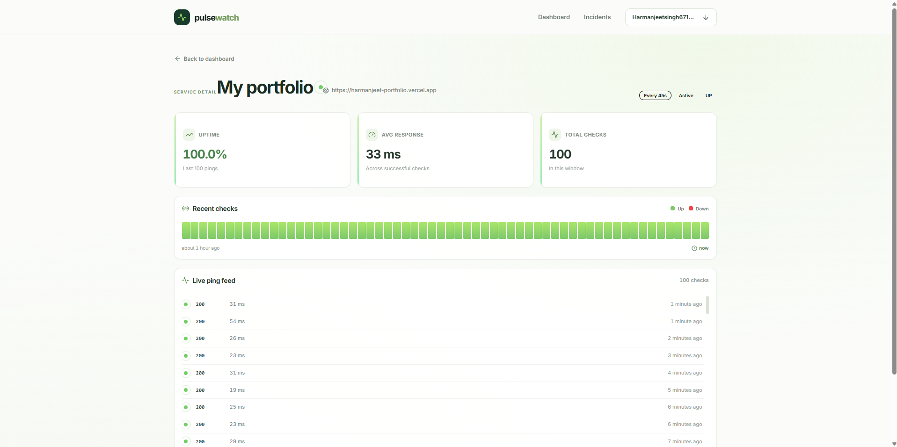

# PulseWatch API

> Backend for **PulseWatch** — a production uptime monitoring platform with AI-powered incident summaries and deterministic anomaly detection.

[](https://pulsewatch-api-gktg.onrender.com/health)
[](https://render.com)
[](https://www.typescriptlang.org/)
[](./LICENSE)

**Live frontend:** [pulsewatch-web-seven.vercel.app](https://pulsewatch-web-seven.vercel.app)
**Live API health:** [pulsewatch-api-gktg.onrender.com/health](https://pulsewatch-api-gktg.onrender.com/health)

---

## What It Does

PulseWatch is a full-stack uptime monitoring service. The backend:

- **Pings URLs on a schedule** (configurable per URL, default 30s) and stores every result
- **Detects outages** with a deterministic state machine — opens an incident on first failure, closes it on first success
- **Flags "degraded" URLs** using rolling z-score anomaly detection (3-sigma threshold), before they fully fail
- **Writes AI incident summaries** via Google Gemini when incidents resolve
- **Sends email alerts** via Resend on incident open and resolve
- **Supports multi-user auth** with JWT + Google OAuth
- **Serves a REST API** consumed by the Next.js dashboard

Built with Fastify, TypeScript, Drizzle ORM, and PostgreSQL. Deployed free on Render + Neon.

---

## Screenshots

### Dashboard — three visual states


UP (green) / DEGRADED (amber, rolling z-score anomaly) / DOWN (red).

### Incidents — AI-generated post-mortems


When an incident resolves, Gemini writes a plain-English summary from the raw ping data.

### URL detail — ping history and uptime stats



---

## Architecture

```
                    +--------------------------+
                    |   Next.js Dashboard      |
                    |        (Vercel)          |
                    +------------+-------------+
                                 | HTTPS
                                 v
+------------------------------------------------------------+
|                  Fastify API + Worker                      |
|                     (Render free tier)                     |
|                                                            |
|  +-------------------+        +----------------------+     |
|  |  HTTP API         |        |  Worker Loop         |     |
|  |  - JWT + OAuth    |        |  Every 10s:          |     |
|  |  - URL CRUD       |        |   - find due URLs    |     |
|  |  - Pings          |        |   - ping in parallel |     |
|  |  - Incidents      |        |   - store results    |     |
|  |  - Status+z-score |        |   - open/close       |     |
|  +---------+---------+        |     incidents        |     |
|            |                  |   - call Gemini on   |     |
|            |                  |     incident close   |     |
|            |                  |   - send email alert |     |
|            |                  +----------+-----------+     |
+------------+-----------------------------+-----------------+
             |                             |
             v                             v
    +----------------+            +--------------+
    |   Postgres     |            |   Gemini     |
    |   (Neon)       |            |   API        |
    |  - users       |            +--------------+
    |  - urls        |            +--------------+
    |  - pings       |----------->|   Resend     |
    |  - incidents   |            |   Email      |
    +----------------+            +--------------+
```

**Request flow:** Frontend -> API -> Postgres.

**Worker flow:** Scheduler -> ping URLs -> Postgres + Gemini + Resend.

---

## The Two AI-Adjacent Features

### 1. Deterministic Anomaly Detection (no AI)

Detection uses **pure statistics**, not AI.

1. Maintain a rolling baseline of successful response times (last 1 hour, up to 120 samples)
2. Compute mean and standard deviation
3. For the latest ping: `z = (current - mean) / stddev`
4. If `z >= 3` — status becomes **"degraded"** (slow but up)

**Why this design:** AI at the decision layer is slow, non-deterministic, and occasionally wrong. Math is fast, deterministic, and correct. Detecting anomalies with math, then explaining them with AI, is the right separation of concerns.

The frontend shows the actual z-score (`z=3.4`) and the baseline comparison (`Current 278ms vs baseline 201ms`), so users understand *why* something was flagged.

### 2. AI Incident Summaries (Gemini)

When an incident resolves, the worker:

1. Gathers raw data — status codes, error messages, latency before/during, duration
2. Builds a structured prompt
3. Calls Gemini 3.8 Flash — **fire-and-forget, non-blocking**
4. Stores the summary on the incident row

**Design principles:**

- **Cached per incident** — one Gemini call per incident, never repeated
- **Graceful fallback** — if Gemini fails, the incident still exists with raw data
- **Prompt versioned** — every summary stores its prompt version for safe iteration
- **AI explains, code decides** — the detection logic never depends on AI

Example output:

> "The portfolio service experienced intermittent 503 Service Unavailable errors for approximately two minutes between 19:19:54 UTC and 19:21:36 UTC on October 11, 2026. The monitoring data logged two 503 errors alongside two successful 200 responses with lower-than-average latency (71ms), which does not provide enough evidence to determine a definitive root cause. The incident resolved automatically as normal responses resumed, leaving the service fully available after the two-minute window."

---

## Tech Stack

| Layer | Tool |
|---|---|
| Runtime | Node.js 20+ |
| Language | TypeScript |
| Framework | Fastify |
| ORM | Drizzle |
| Database | PostgreSQL (Neon) |
| Auth | JWT + bcrypt + Google OAuth |
| AI | Google Gemini 3.8 Flash |
| Email | Resend |
| Logging | Pino |
| Testing | Vitest |
| Deployment | Render |
| Keep-alive | cron-job.org |

---

## API Reference

Base URL: `https://pulsewatch-api-gktg.onrender.com`

### Auth

| Method | Path | Auth | Description |
|---|---|---|---|
| POST | `/api/v1/auth/register` | No | Create user with email + password |
| POST | `/api/v1/auth/login` | No | Sign in with email + password |
| GET | `/api/v1/auth/google` | No | Redirect to Google consent |
| GET | `/api/v1/auth/google/callback` | No | Handle Google OAuth callback |
| GET | `/api/v1/auth/me` | Yes | Current user info |

### URLs

| Method | Path | Auth | Description |
|---|---|---|---|
| GET | `/api/v1/urls` | Yes | List URLs with status, z-score, baseline stats |
| POST | `/api/v1/urls` | Yes | Register a URL for monitoring |
| GET | `/api/v1/urls/:id` | Yes | One URL with recent pings |
| PATCH | `/api/v1/urls/:id` | Yes | Update name, interval, or active state |
| DELETE | `/api/v1/urls/:id` | Yes | Remove URL (cascades to pings + incidents) |
| GET | `/api/v1/urls/:id/pings` | Yes | Paginated ping history |

### Incidents

| Method | Path | Auth | Description |
|---|---|---|---|
| GET | `/api/v1/incidents` | Yes | List incidents (filters: status, urlId) |
| GET | `/api/v1/incidents/:id` | Yes | One incident + pings during the outage |

### Health

| Method | Path | Auth | Description |
|---|---|---|---|
| GET | `/health` | No | Health check (used by external cron) |

### Example: `GET /api/v1/urls`

```json
[
  {
    "id": 8,
    "url": "https://example.com",
    "name": "Anomaly Test",
    "isActive": true,
    "status": "degraded",
    "zScore": 3.4,
    "baselineMean": 201,
    "baselineStdDev": 22,
    "recentPings": [
      {
        "statusCode": 200,
        "responseTimeMs": 278,
        "isUp": true,
        "checkedAt": "2026-10-13T18:17:09.821Z"
      }
    ]
  }
]
```

---

## Local Development

### Prerequisites

- Node.js 20+
- pnpm
- A free [Neon Postgres database](https://neon.tech)
- (Optional) [Gemini API key](https://aistudio.google.com/apikey) for AI summaries
- (Optional) [Resend API key](https://resend.com) for email alerts
- (Optional) Google OAuth credentials for Google sign-in

### Setup

```bash
git clone https://github.com/HarmanjeetSingh2501/pulsewatch-api.git
cd pulsewatch-api
pnpm install
cp .env.example .env
# Edit .env with your DATABASE_URL and other keys
pnpm db:push
pnpm dev
```

Server starts on `http://localhost:3000`.

### Environment Variables

| Variable | Required | Purpose |
|---|---|---|
| `DATABASE_URL` | Yes | Neon Postgres connection string |
| `JWT_SECRET` | Yes | 32-byte hex for signing JWT tokens |
| `FRONTEND_URL` | Yes | CORS origin (e.g. `http://localhost:3001`) |
| `GEMINI_API_KEY` | Optional | Enables AI incident summaries |
| `RESEND_API_KEY` | Optional | Enables email alerts |
| `GOOGLE_CLIENT_ID` | Optional | Enables Google OAuth |
| `GOOGLE_CLIENT_SECRET` | Optional | Same |
| `GOOGLE_REDIRECT_URI` | Optional | Google OAuth callback URL |
| `PORT` | Optional | Defaults to 3000 |

Generate a JWT secret:

```bash
node -e "console.log(require('crypto').randomBytes(32).toString('hex'))"
```

### Google OAuth Setup (Optional)

1. Create a project at [console.cloud.google.com](https://console.cloud.google.com)
2. Configure the OAuth consent screen (External)
3. Add test users (anyone who needs to sign in)
4. Create OAuth 2.0 credentials (Web application)
5. Add authorized redirect URIs:
   - `http://localhost:3000/api/v1/auth/google/callback`
   - `https://your-render-url.onrender.com/api/v1/auth/google/callback`
6. Paste the Client ID + Secret into `.env`

---

## Where This Breaks

Honest limitations — things I'd fix at scale:

| Limitation | Why | Mitigation |
|---|---|---|
| Single worker, single region | Worker loop runs inside the API process | Would need Redis-based locking + a separate worker service |
| Postgres grows ~2,880 pings/URL/day | Append-only `pings` table | Retention job (delete >30 days) + hourly rollups planned |
| Render free tier sleeps after 15 min | Platform limitation | cron-job.org hits `/health` every 10 min |
| Anomaly detection assumes stable baselines | Rolling z-score fails on naturally variable latency | Percentile-based algorithm (compare to p95 of the window) would be better |
| AI summaries are fire-and-forget | Gemini takes 3-7s | If the process crashes mid-call, the summary is lost (raw incident data survives) |
| Resend free tier sends to signup email only | Unverified sender domain | Emails route to Spam for other recipients; would verify a custom domain |
| Google OAuth app is unverified | Google requires review for public apps | Test users can sign in; publishing requires Google verification |

---

## Roadmap

- [x] Week 1 — Core API, worker loop, incident detection
- [x] Week 2 — AI summaries (Gemini), rolling z-score anomaly detection
- [x] Week 3 — Frontend dashboard, URL CRUD
- [x] Week 4 — Email alerts (Resend), JWT auth
- [x] Week 4 — Google OAuth sign-in
- [ ] Week 5 — Retention job + rollups, k6 load test, multi-region checks

---

## Related Repos

- **Frontend:** [pulsewatch-web](https://github.com/HarmanjeetSingh2501/pulsewatch-web)
- **Live app:** [pulsewatch-web-seven.vercel.app](https://pulsewatch-web-seven.vercel.app)

---

## License

MIT — see [LICENSE](./LICENSE)